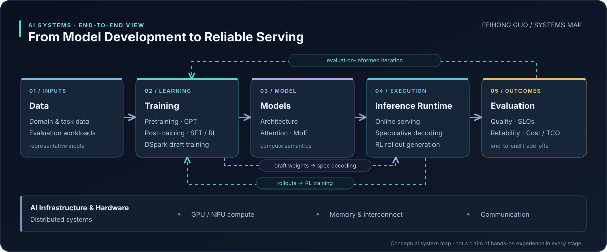

<h1 align="center">Feihong Guo</h1>

  <b>AI Systems · LLM Inference Engineering</b> 
  Model Adaptation · Distributed Serving · GPU/NPU Performance

  <a href="https://phoenix3334.github.io/">Personal Website</a> ·
  <a href="https://phoenix3334.github.io/blog/">Engineering Notes</a> ·
  <a href="https://github.com/sgl-project/sglang/pulls?q=is%3Apr+author%3APhoenix3334">SGLang PRs</a> ·
  <a href="https://github.com/stars/Phoenix3334/lists/ai-infra">AI Infra Reading List</a>

## About

I focus on **LLM inference systems** — from model adaptation to GPU/NPU runtime optimization and serving capacity evaluation.

聚焦**大模型推理系统**：从模型适配到 GPU/NPU 运行时优化与推理服务容量评估。

## Selected Work

**[SGLang · Distributed LLM Serving](https://github.com/sgl-project/sglang)** — Benchmarked and debugged DeepSeek/Kimi inference on NVIDIA H200, B300 and GB300, covering Prefill/Decode, parallel configurations, runtime correctness and service capacity.

- **Runtime correctness:** [DP health routing #35721](https://github.com/sgl-project/sglang/pull/35721) · [Async PP stream lifetime #47614](https://github.com/sgl-project/sglang/pull/47614)
- **Kernel & configuration work:** [Inverse RoPE + FP8 fusion #43786](https://github.com/sgl-project/sglang/pull/43786) · [EPLB validation #48404](https://github.com/sgl-project/sglang/pull/48404)

**[MiniCPM-o 4.5 · Full-Duplex Inference](https://github.com/Phoenix3334/minicpmo45-ascend)** — Connected DSpark draft training on B300/DP8 with GGUF deployment and llama.cpp-omni / ggml-CANN optimization on Ascend 910C. Worked on TileLang kernels, ACL Graph and Flow/Vocoder execution; paired 120 s duplex **core RTF: 0.6754 → 0.4829 (−28.5%)**.

**[ThermoPulse · Medical AI Prototype](https://phoenix3334.github.io/#medical)** — A measurement-to-report system spanning long-wave infrared acquisition, YOLOv11 localization, **ResNet18 + Transformer spatial dual-stream vision**, CUDA/TensorRT deployment work, and **Qwen3-8B CPT → SFT** for structured medical reporting.

## Platforms & Tooling

- **Hardware:** NVIDIA H200 / B300 / GB300 · Ascend 910B / 910C · Kunpeng 920
- **Serving & training:** SGLang · vLLM / vLLM-Ascend · llama.cpp-omni · PyTorch · DeepSpeed
- **Kernels & systems:** CUDA / CANN · Triton · TileLang · NCCL · Nsight Systems / Compute

## Systems View

  

## Contact

[Email](mailto:1187883824@qq.com) · [Personal Website](https://phoenix3334.github.io/)
